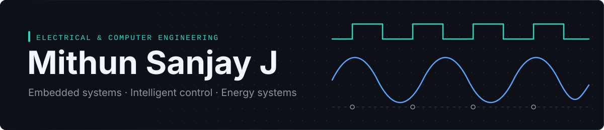

  
  
  
  

  
  
  

---

### 👨‍💻 About

I build at the boundary between hardware and intelligence: firmware that talks to real peripherals, and soft-computing models that decide how real power systems should behave. I'm a B.Tech Electrical and Computer Engineering student at Amrita Vishwa Vidyapeetham.

### 🔭 Focus areas

| | |
|---|---|
| ⚙️ **Embedded firmware** | STM32 (NUCLEO-F401RE), starting from the bus level with I2C master/slave |
| 🔋 **Intelligent control &amp; energy** | Fuzzy logic, ANFIS, GA/PSO and neural optimisation for motors, batteries and economic dispatch |
| 📡 **Applied ML** | Signal classification and AI-agent tooling |

### 🧪 Featured projects

<table>
  <tr>
    <td width="50%" valign="top">
      <h4><a href="https://github.com/GSKHEWUFUEGIBF/exp6-fuzzy-adaptive-eld">exp6-fuzzy-adaptive-eld</a></h4>
      Six-unit thermal economic load dispatch comparing standard GA, fuzzy-adaptive GA and fuzzy-supervised PSO under transmission losses and operating constraints.  
      
    </td>
    <td width="50%" valign="top">
      <h4><a href="https://github.com/GSKHEWUFUEGIBF/exp5-anfis-battery-soc">exp5-anfis-battery-soc</a></h4>
      ANFIS pipelines estimating battery state-of-charge from voltage, current and temperature, with training-only Z-score normalisation to avoid leakage.  
       
    </td>
  </tr>
  <tr>
    <td width="50%" valign="top">
      <h4><a href="https://github.com/GSKHEWUFUEGIBF/exp4-home-economic-load-dispatch">exp4-home-economic-load-dispatch</a></h4>
      24-hour home-energy dispatch across solar PV, battery, grid and diesel, comparing lambda iteration with a Hopfield neural network.  
      
    </td>
    <td width="50%" valign="top">
      <h4><a href="https://github.com/GSKHEWUFUEGIBF/agentwallet">agentwallet</a></h4>
      Spending-rules wallet for AI shopping agents, funded and settled through PayPal.  
      
    </td>
  </tr>
  <tr>
    <td width="50%" valign="top">
      <h4><a href="https://github.com/GSKHEWUFUEGIBF/rf-signal-classifier">rf-signal-classifier</a></h4>
      RF signal classification with transfer learning on SqueezeNet (MathWorks Challenge #245).  
      
    </td>
    <td width="50%" valign="top">
      <h4><a href="https://github.com/GSKHEWUFUEGIBF/i2c">i2c</a></h4>
      I2C master and slave implementation on the NUCLEO-F401RE.  
       
    </td>
  </tr>
</table>

More: [Mamdani fuzzy vs PID DC-motor control](https://github.com/GSKHEWUFUEGIBF/exp3-mamdani-dc-motor-control)

### 🛠️ Toolbox

**Languages:** C · MATLAB · Python · JavaScript · TypeScript  
**Embedded:** STM32 (NUCLEO-F401RE) · I2C  
**Modelling &amp; ML:** Simulink · Fuzzy logic (Mamdani) · ANFIS · GA / PSO · Hopfield networks · Transfer learning  
**Workflow:** Git · GitHub

### 📊 GitHub stats

  
  

### 🤝 Let's collaborate

Open to collaborating on embedded systems, energy-management and control projects, and to internship or research opportunities in these areas.

